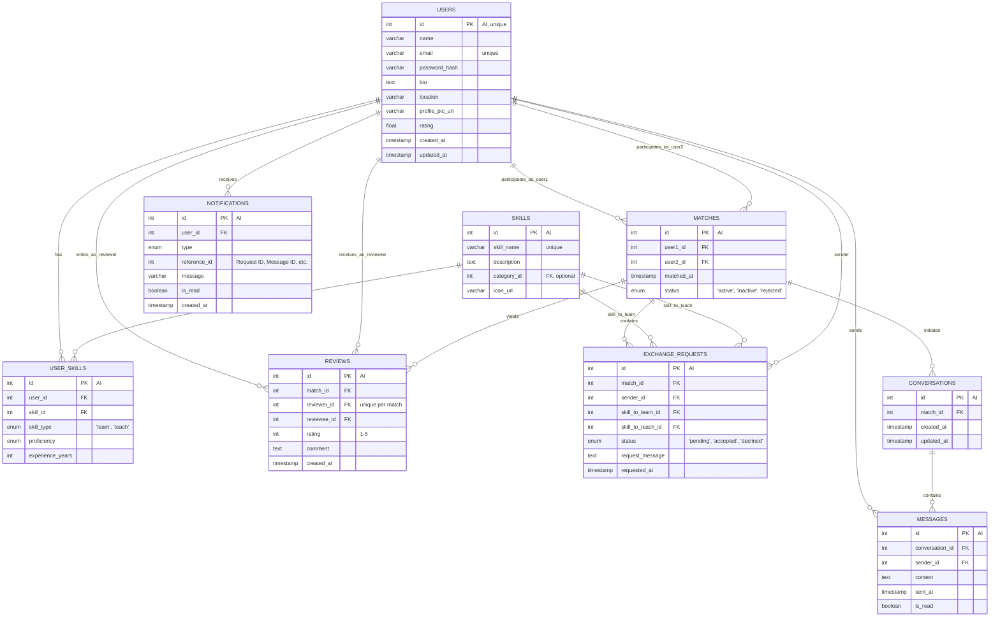

# Database Normalization — Skillor

**File:** `01_normalization.md`  
**Project:** Skillor — Skill Exchange Platform  
**Database:** PostgreSQL  
**Purpose:** Document how Skillor's relational database schema is structured to eliminate redundancy, prevent update anomalies, and maintain data integrity in accordance with the official **Platform Database ERD**.

---

## 1. What is Normalization?

Database normalization is the systematic process of organizing relational tables to minimize data redundancy and eliminate anomalies during data modification (inserts, updates, and deletes).

For Skillor, normalization is essential because the platform manages interconnected workflows spanning:

- **Users:** Authentication credentials, public profile details, and user ratings.
- **Skills Catalog:** Curated skills available across the platform with optional categorization.
- **User Skills:** Mapping which users teach or want to learn specific skills, along with proficiency and years of experience.
- **Matches:** Matched pairings formed between two users.
- **Exchange Requests:** Skill barter requests linking a match, a sender, and the exchanged skills.
- **Conversations & Messages:** Real-time communication channels between matched users.
- **Reviews:** Bilateral feedback and 1–5 star ratings exchanged between matched participants.
- **Notifications:** Polymorphic system, match, and message alerts delivered to users.

Normalizing these entities into well-defined relational tables ensures that each fact is stored in exactly one place while foreign keys preserve referential integrity.

---

## 2. Example of an Unnormalized Design

Imagine storing a user's profile, skill interests, exchange requests, and partner details in a single flat table:

### `user_exchange_data` — Unnormalized Example (0NF)

| user_id | name | email | skills_to_teach | skills_to_learn | partner_name | skill_to_learn | skill_to_teach | match_status |
|---|---|---|---|---|---|---|---|---|
| 1 | Aarav | aarav@example.com | React, Node.js | UI/UX | Meera | React | UI/UX | active |
| 1 | Aarav | aarav@example.com | React, Node.js | UI/UX | Kabir | Node.js | Python | active |

This unnormalized structure introduces serious database anomalies:

1. **Repeating Groups:** Cells such as `skills_to_teach` contain comma-separated lists instead of atomic values.
2. **Data Duplication:** Aarav's name, email, and skills are duplicated across every exchange interaction.
3. **Update Anomaly:** If Aarav updates his email or adds a skill, multiple rows across the database must be updated. Any missed row results in inconsistent state.
4. **Insertion Anomaly:** A new user cannot be registered without simultaneously creating a dummy match or exchange request.
5. **Deletion Anomaly:** Deleting a cancelled exchange record could inadvertently delete the only record of Aarav's profile or his skills.

Normalization resolves these design flaws through progressive normal forms.

---

## 3. First Normal Form (1NF)

A table satisfies **First Normal Form (1NF)** when:

- Every column contains strictly **atomic (indivisible)** values.
- There are **no repeating groups** or multi-valued attributes (e.g., no CSV strings or nested arrays).
- Each record is uniquely identifiable by a primary key (`PK`).
- Column data types are consistent throughout the column.

### Before 1NF

| user_id | name | skills_to_teach |
|---|---|---|
| 1 | Aarav | React, Node.js |

The `skills_to_teach` column contains non-atomic, composite values.

### After 1NF

We decompose the repeating groups into atomic rows across normalized tables using a junction table:

**`users`**

| id (PK) | name | email |
|---|---|---|
| 1 | Aarav | aarav@example.com |

**`skills`**

| id (PK) | skill_name |
|---|---|
| 10 | React |
| 11 | Node.js |

**`user_skills`**

| id (PK) | user_id (FK) | skill_id (FK) | skill_type |
|---|---|---|---|
| 1 | 1 | 10 | teach |
| 2 | 1 | 11 | teach |

Every attribute now holds a single atomic value. Users can teach or learn arbitrary numbers of skills without altering schema structure.

---

## 4. Second Normal Form (2NF)

A table satisfies **Second Normal Form (2NF)** when:

- It is already in **1NF**.
- It contains **no partial dependencies**: every non-key attribute is fully functionally dependent on the primary key (especially critical when composite primary keys are present).

### Example Problem

Suppose `user_skills` were modeled with a composite key `(user_id, skill_id)` and also held descriptive details:

| user_id (PK) | skill_id (PK) | user_name | skill_name | skill_type | proficiency | experience_years |
|---|---|---|---|---|---|---|
| 1 | 10 | Aarav | React | teach | advanced | 4 |
| 1 | 11 | Aarav | Node.js | teach | intermediate | 2 |

Here:
- `user_name` depends solely on `user_id` (partial dependency).
- `skill_name` depends solely on `skill_id` (partial dependency).
- Only `skill_type`, `proficiency`, and `experience_years` depend on the combined pairing of `(user_id, skill_id)`.

### 2NF Decomposed Design

To achieve 2NF, we separate user facts into `users`, skill definitions into `skills`, and preserve relationship attributes inside `user_skills`:

- **`users`**(`id`, `name`, `email`, ...)
- **`skills`**(`id`, `skill_name`, `description`, ...)
- **`user_skills`**(`id`, `user_id`, `skill_id`, `skill_type`, `proficiency`, `experience_years`)

> **Skillor Design Note:** While `user_skills` uses a surrogate key `id` as its primary key, a business-rule unique constraint `UNIQUE (user_id, skill_id, skill_type)` ensures a user cannot register duplicate entries for the exact same skill role.

---

## 5. Third Normal Form (3NF)

A table satisfies **Third Normal Form (3NF)** when:

- It is already in **2NF**.
- It contains **no transitive dependencies**: non-key attributes must depend directly on the primary key, and not on another non-key attribute ("every non-key column must depend on the key, the whole key, and nothing but the key, so help me Codd").

### Example Problem in Exchange Requests

Consider a poorly normalized request record:

| id (PK) | match_id | sender_id | sender_name | skill_to_learn_id | skill_to_learn_name | skill_to_teach_id | skill_to_teach_name | status |
|---|---|---|---|---|---|---|---|---|
| 101 | 5 | 1 | Aarav | 10 | React | 11 | Node.js | pending |

Here, non-key attributes depend transitively on foreign keys rather than the record itself:
- `sender_id → sender_name`
- `skill_to_learn_id → skill_to_learn_name`
- `skill_to_teach_id → skill_to_teach_name`

Duplicating names creates transitive redundancy and potential update inconsistencies.

### 3NF Normalized Design

In 3NF, `exchange_requests` stores only foreign key references:

**`exchange_requests`**

| id (PK) | match_id (FK) | sender_id (FK) | skill_to_learn_id (FK) | skill_to_teach_id (FK) | status | request_message | requested_at |
|---|---|---|---|---|---|---|---|
| 101 | 5 | 1 | 10 | 11 | pending | "Looking forward to swapping skills!" | 2026-11-15 10:00:00 |

User names and skill names are resolved on demand via relational `JOIN` operations against `users` and `skills`.

---

## 6. Official Normalized Schema for Skillor

The following relational schema matches the **Platform Database ERD**, detailing data types, keys, constraints, and business domain purposes across all 9 entities.

### 6.1 `USERS`

Stores account credentials, profile details, and user rating metrics.

| Column | Data Type | Constraint | Description |
|---|---|---|---|
| `id` | `INTEGER` | PK, AI, UNIQUE | Unique identifier for the user account |
| `name` | `VARCHAR` | NOT NULL | User's full or display name |
| `email` | `VARCHAR` | UNIQUE, NOT NULL | Account email address for login and notifications |
| `password_hash` | `VARCHAR` | NOT NULL | Secure salted cryptographic hash of user password |
| `bio` | `TEXT` | NULL | Biographical summary and background |
| `location` | `VARCHAR` | NULL | City, region, or time zone of user |
| `profile_pic_url` | `VARCHAR` | NULL | URL reference to user's profile avatar |
| `rating` | `FLOAT` | DEFAULT 0.0 | Cached aggregate rating (see Section 10 on controlled denormalization) |
| `created_at` | `TIMESTAMP` | NOT NULL | Account registration timestamp |
| `updated_at` | `TIMESTAMP` | NOT NULL | Profile last-updated timestamp |

---

### 6.2 `SKILLS`

The platform-wide skill catalogue that users can offer to teach or request to learn.

| Column | Data Type | Constraint | Description |
|---|---|---|---|
| `id` | `INTEGER` | PK, AI | Unique skill identifier |
| `skill_name` | `VARCHAR` | UNIQUE, NOT NULL | Standardized skill name (e.g., 'React', 'Python', 'UI/UX') |
| `description` | `TEXT` | NULL | Detailed description of the skill curriculum or scope |
| `category_id` | `INTEGER` | FK, Optional | Optional reference to a broader subject area / category |
| `icon_url` | `VARCHAR` | NULL | Asset URL for skill badge or icon display |

---

### 6.3 `USER_SKILLS`

Junction table mapping users to skills with role-specific metadata.

| Column | Data Type | Constraint | Description |
|---|---|---|---|
| `id` | `INTEGER` | PK, AI | Unique record identifier |
| `user_id` | `INTEGER` | FK, NOT NULL | References `USERS(id)` (ON DELETE CASCADE) |
| `skill_id` | `INTEGER` | FK, NOT NULL | References `SKILLS(id)` (ON DELETE RESTRICT) |
| `skill_type` | `ENUM` | NOT NULL | Purpose: `'learn'` or `'teach'` |
| `proficiency` | `ENUM` | NOT NULL | Skill tier (e.g., `'beginner'`, `'intermediate'`, `'advanced'`, `'expert'`) |
| `experience_years` | `INTEGER` | DEFAULT 0 | Number of years of practical experience |

*Unique Constraint:* `UNIQUE (user_id, skill_id, skill_type)` prevents duplicate listings for the same user and skill role.

---

### 6.4 `MATCHES`

Records a confirmed match pairing between two registered users.

| Column | Data Type | Constraint | Description |
|---|---|---|---|
| `id` | `INTEGER` | PK, AI | Unique match identifier |
| `user1_id` | `INTEGER` | FK, NOT NULL | First participant, references `USERS(id)` |
| `user2_id` | `INTEGER` | FK, NOT NULL | Second participant, references `USERS(id)` |
| `matched_at` | `TIMESTAMP` | NOT NULL | Timestamp when the match was established |
| `status` | `ENUM` | NOT NULL | Status: `'active'`, `'inactive'`, or `'rejected'` |

*Integrity Check:* `CHECK (user1_id <> user2_id)` ensures a user cannot be matched with themselves.

---

### 6.5 `EXCHANGE_REQUESTS`

Manages skill exchange proposals associated with a match, capturing sender intent and exchanged skills.

| Column | Data Type | Constraint | Description |
|---|---|---|---|
| `id` | `INTEGER` | PK, AI | Unique exchange request identifier |
| `match_id` | `INTEGER` | FK, NOT NULL | Associated match, references `MATCHES(id)` |
| `sender_id` | `INTEGER` | FK, NOT NULL | Initiator of proposal, references `USERS(id)` |
| `skill_to_learn_id` | `INTEGER` | FK, NOT NULL | Skill the sender wants to learn, references `SKILLS(id)` |
| `skill_to_teach_id` | `INTEGER` | FK, NOT NULL | Skill the sender offers to teach, references `SKILLS(id)` |
| `status` | `ENUM` | NOT NULL | Request status: `'pending'`, `'accepted'`, `'declined'` |
| `request_message` | `TEXT` | NULL | Intro message or proposal pitch sent with request |
| `requested_at` | `TIMESTAMP` | NOT NULL | Timestamp when proposal was submitted |

---

### 6.6 `CONVERSATIONS`

Represents direct communication channels created for matched users.

| Column | Data Type | Constraint | Description |
|---|---|---|---|
| `id` | `INTEGER` | PK, AI | Unique conversation thread identifier |
| `match_id` | `INTEGER` | FK, NOT NULL | References `MATCHES(id)` |
| `created_at` | `TIMESTAMP` | NOT NULL | Conversation thread creation timestamp |
| `updated_at` | `TIMESTAMP` | NOT NULL | Last activity / latest message timestamp |

---

### 6.7 `MESSAGES`

Individual chat messages transmitted within a conversation thread.

| Column | Data Type | Constraint | Description |
|---|---|---|---|
| `id` | `INTEGER` | PK, AI | Unique message identifier |
| `conversation_id` | `INTEGER` | FK, NOT NULL | References `CONVERSATIONS(id)` (ON DELETE CASCADE) |
| `sender_id` | `INTEGER` | FK, NOT NULL | Author of the message, references `USERS(id)` |
| `content` | `TEXT` | NOT NULL | Text body of the message |
| `sent_at` | `TIMESTAMP` | NOT NULL | Timestamp when the message was dispatched |
| `is_read` | `BOOLEAN` | DEFAULT FALSE | Read receipt status indicator |

---

### 6.8 `REVIEWS`

Bilateral feedback, ratings, and testimonials provided by matched users upon exchange completion.

| Column | Data Type | Constraint | Description |
|---|---|---|---|
| `id` | `INTEGER` | PK, AI | Unique review identifier |
| `match_id` | `INTEGER` | FK, NOT NULL | References `MATCHES(id)` |
| `reviewer_id` | `INTEGER` | FK, NOT NULL | User giving feedback, references `USERS(id)` |
| `reviewee_id` | `INTEGER` | FK, NOT NULL | User receiving feedback, references `USERS(id)` |
| `rating` | `INTEGER` | NOT NULL | Rating score strictly constrained between `1` and `5` |
| `comment` | `TEXT` | NULL | Optional written testimonial / review remarks |
| `created_at` | `TIMESTAMP` | NOT NULL | Timestamp when review was submitted |

*Integrity Constraints:*
- `CHECK (rating >= 1 AND rating <= 5)`
- `CHECK (reviewer_id <> reviewee_id)`
- `UNIQUE (match_id, reviewer_id)` ensures a user can review their match partner only once per match.

---

### 6.9 `NOTIFICATIONS`

System, request, and activity alerts delivered to users.

| Column | Data Type | Constraint | Description |
|---|---|---|---|
| `id` | `INTEGER` | PK, AI | Unique notification identifier |
| `user_id` | `INTEGER` | FK, NOT NULL | Recipient user, references `USERS(id)` |
| `type` | `ENUM` | NOT NULL | Category of notification (e.g., `'request'`, `'message'`, `'review'`, `'match'`) |
| `reference_id` | `INTEGER` | NOT NULL | Contextual foreign ID (e.g., Request ID, Message ID, Match ID) |
| `message` | `VARCHAR` | NOT NULL | User-facing notification text preview |
| `is_read` | `BOOLEAN` | DEFAULT FALSE | Read status flag |
| `created_at` | `TIMESTAMP` | NOT NULL | Alert generation timestamp |

---

## 7. Relationship Overview & ERD

### 7.1 Text Cardinality Summary

```text
USERS (1) ────< (N) USER_SKILLS (N) >──── (1) SKILLS
  │                     │
  │                     └─ (skill_type: 'learn' | 'teach')
  ├──── (1) ───< (N) MATCHES (user1_id, user2_id)
  │                     │
  │                     ├──── (1) ───< (N) EXCHANGE_REQUESTS
  │                     │                     │
  │                     │                     ├──> (N) : (1) SKILLS (skill_to_learn_id)
  │                     │                     └──> (N) : (1) SKILLS (skill_to_teach_id)
  │                     │
  │                     ├──── (1) ───< (1..N) CONVERSATIONS
  │                     │                            │
  │                     │                            └──── (1) ───< (N) MESSAGES
  │                     │
  │                     └──── (1) ───< (1..2) REVIEWS (reviewer_id, reviewee_id)
  │
  ├──── (1) ───< (N) MESSAGES (sender_id)
  │
  ├──── (1) ───< (N) REVIEWS (reviewer_id, reviewee_id)
  │
  └──── (1) ───< (N) NOTIFICATIONS (user_id)
```

### 7.2 Mermaid Entity-Relationship Diagram



---

## 8. Normalization Summary

| Normal Form | Rule Description | Application in Skillor Schema |
|---|---|---|
| **1NF** | Atomic column values; no repeating groups or CSV arrays. | User-skill relationships are stored as atomic individual rows in `USER_SKILLS`. Messages and notifications are distinct rows rather than serialized arrays. |
| **2NF** | Meets 1NF; no partial functional dependencies on composite candidate keys. | Attributes such as `skill_name` reside strictly in `SKILLS`. Relationship-specific data (`proficiency`, `experience_years`, `skill_type`) resides in `USER_SKILLS`. |
| **3NF** | Meets 2NF; no transitive dependencies between non-key attributes. | User details (`name`, `email`) and skill details (`skill_name`) are not duplicated inside `EXCHANGE_REQUESTS`, `MESSAGES`, or `REVIEWS`. Tables hold foreign key IDs only. |

---

## 9. Integrity Constraints and Indexing Strategy

Relational integrity is guarded by explicit constraints and indexes:

### 9.1 Key Constraints

- **Primary Keys:** Every table features an auto-incrementing integer primary key (`id`).
- **Unique Constraints:**
  - `USERS(email)`: Guarantees unique accounts.
  - `SKILLS(skill_name)`: Prevents duplicate skill definitions.
  - `USER_SKILLS(user_id, skill_id, skill_type)`: Prevents duplicate skill associations for the same role.
  - `REVIEWS(match_id, reviewer_id)`: Enforces at most one review per participant per match.

### 9.2 Domain & Check Constraints

- `REVIEWS.rating`: `CHECK (rating >= 1 AND rating <= 5)`.
- `USER_SKILLS.experience_years`: `CHECK (experience_years >= 0)`.
- Self-reference prevention:
  - `MATCHES`: `CHECK (user1_id <> user2_id)`.
  - `REVIEWS`: `CHECK (reviewer_id <> reviewee_id)`.

### 9.3 Foreign Key Cascades

- **`CASCADE` Deletion:**
  - `USER_SKILLS` cascades on `USERS.id` deletion.
  - `MESSAGES` cascades on `CONVERSATIONS.id` deletion.
  - `NOTIFICATIONS` cascades on `USERS.id` deletion.
- **`RESTRICT` / `NO ACTION`:**
  - `SKILLS` deletion is restricted if referenced by active `USER_SKILLS` or `EXCHANGE_REQUESTS` to protect historical audit trails.
  - `MATCHES` and `REVIEWS` maintain audit integrity and are retained or marked `inactive` / soft-deleted rather than hard-cascaded.

### 9.4 Recommended Indexes

To ensure sub-millisecond query execution on frequent joins and filters:

```sql
-- Fast lookup of user skills
CREATE INDEX idx_user_skills_user_id ON USER_SKILLS(user_id);
CREATE INDEX idx_user_skills_skill_id ON USER_SKILLS(skill_id);

-- Match lookups by participant
CREATE INDEX idx_matches_user1_id ON MATCHES(user1_id);
CREATE INDEX idx_matches_user2_id ON MATCHES(user2_id);
CREATE INDEX idx_matches_status ON MATCHES(status);

-- Message queries for conversations (chronological order)
CREATE INDEX idx_messages_conv_sent ON MESSAGES(conversation_id, sent_at);

-- Unread notification lookups
CREATE INDEX idx_notifications_user_unread ON NOTIFICATIONS(user_id, is_read);

-- Exchange request filtering
CREATE INDEX idx_exchange_requests_match ON EXCHANGE_REQUESTS(match_id);
CREATE INDEX idx_exchange_requests_sender ON EXCHANGE_REQUESTS(sender_id);
```

---

## 10. Controlled Denormalization in the Schema

While 3NF is the gold standard for OLTP systems, deliberate, controlled denormalization is applied in one specific location in this schema:

### `USERS.rating` (Float)

- **Authoritative 3NF Source:** `REVIEWS.rating` (Integer, 1–5).
- **The Denormalized Attribute:** `USERS.rating` stores a precomputed, cached average rating for each user.
- **Justification:** Every user search query, profile visit, and match recommendation screen displays the user's average rating. Computing `AVG(rating)` with a `JOIN` across thousands of `REVIEWS` rows on every browse request would severely degrade database throughput.
- **Maintenance Strategy:** The cache is updated either via:
  1. A database trigger on `INSERT`/`UPDATE`/`DELETE` in `REVIEWS`.
  2. An asynchronous worker or application service transaction that updates `USERS.rating = (SELECT AVG(rating) FROM REVIEWS WHERE reviewee_id = NEW.reviewee_id)`.

---

## 11. Conclusion

Skillor's database schema rigorously adheres to **Third Normal Form (3NF)** principles while implementing practical optimizations for a real-world platform:

1. **Entity Separation:** 9 distinct relational tables isolate domain concerns: Users, Skills, User-Skill relationships, Matches, Exchange Requests, Conversations, Messages, Reviews, and Notifications.
2. **Elimination of Anomalies:** Redundant skill names and user profiles are eliminated from transactional tables, ensuring updates to emails or skills require modifying a single row.
3. **Data Integrity:** Foreign keys, enums (`'learn'`/`'teach'`, `'active'`/`'inactive'`/`'rejected'`, `'pending'`/`'accepted'`/`'declined'`), check constraints, and composite unique keys protect database consistency.
4. **Optimized Read Performance:** Targeted indexing and the controlled caching of aggregate ratings in `USERS.rating` strike the optimal balance between 3NF purity and real-time production performance.
